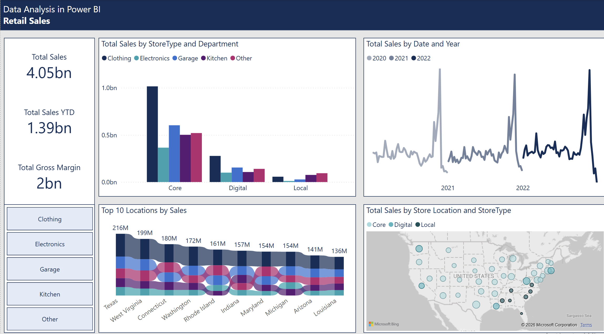
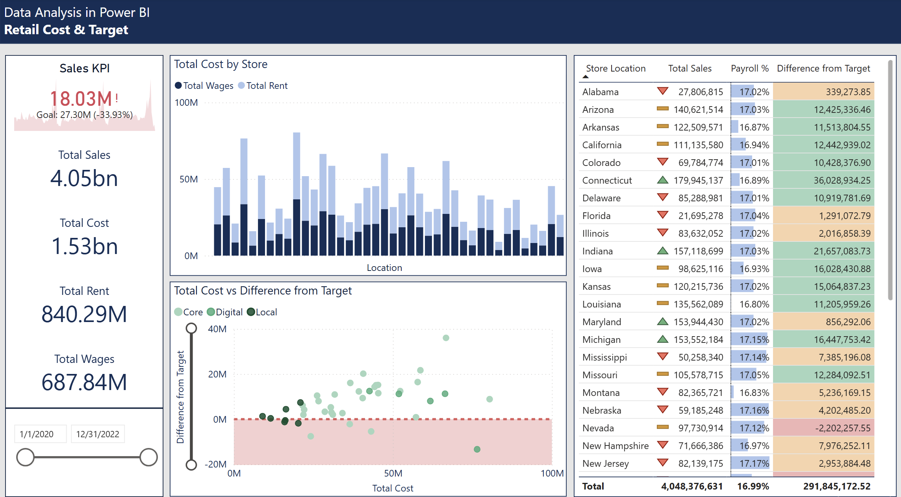
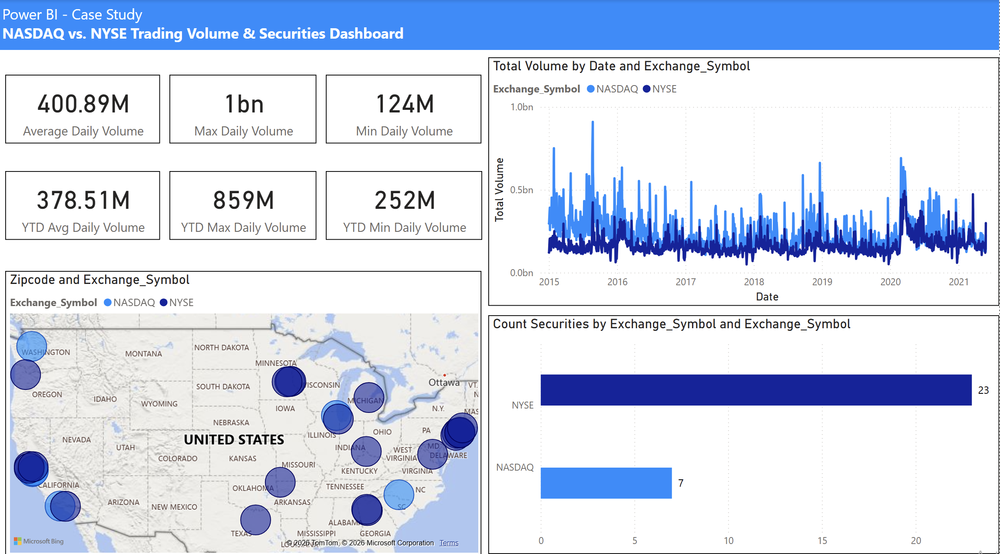
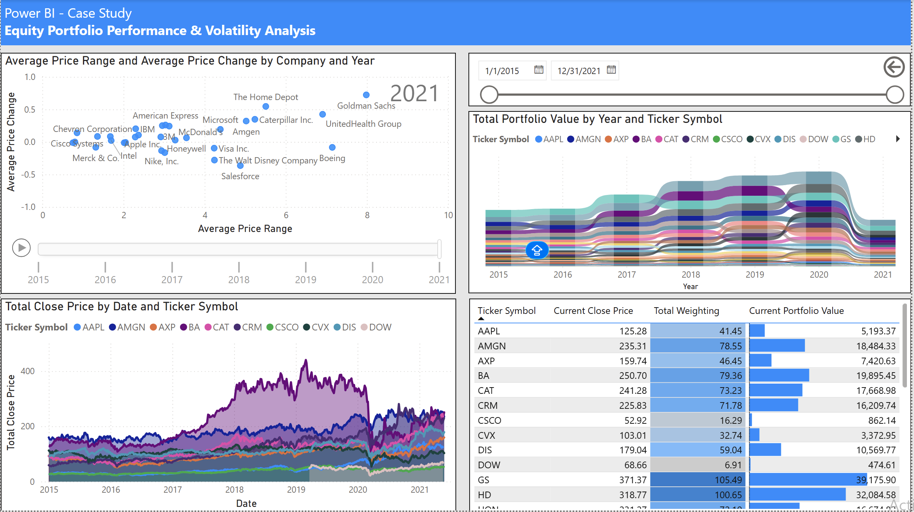

# Power BI Projects

A collection of four interactive business intelligence Power BI dashboards developed as part of the **Business Intelligence & Data Analyst (BIDA) Certification**. These projects apply data preparation, transformation, modelling and visualization techniques to retail analytics, financial markets and equity portfolio analysis.

## Projects

### 1. Retail Sales Dashboard



Analyzes retail sales performance across departments, store types, geographic locations and time periods.

**Key Features:**
- KPI cards displaying total sales, year-to-date (YTD) sales and gross margin.
- Clustered column charts comparing sales across departments and store types.
- Time-series line charts tracking sales trends across multiple years.
- Ribbon-style visualization comparing the contribution of store types across top-performing locations.
- Geographic bubble map displaying sales distribution by store location.
- Interactive department filters for segmenting sales performance.

### 2. Retail Cost & Target Dashboard



Evaluates retail operating costs, sales performance and deviations from predefined targets across store locations.

**Key Features:**
- KPI cards tracking sales, total costs, rent, wages and sales performance against targets.
- Stacked column charts comparing wage and rental costs across locations.
- Scatter plot analyzing the relationship between total costs and deviations from target, with a reference line highlighting the target threshold.
- Conditional formatting in tabular reports, including data bars, color-coded performance indicators and background color scales.
- Store-level comparisons of sales, payroll percentages and target variances.
- Interactive date-range slicer for filtering performance across selected periods.

### 3. NASDAQ vs. NYSE Trading Volume & Securities Dashboard



Compares trading activity and securities distribution across the NASDAQ and New York Stock Exchange (NYSE).

**Key Features:**
- KPI cards displaying average, maximum and minimum daily trading volumes, alongside YTD statistics.
- Time-series line charts comparing daily trading volumes across exchanges.
- Horizontal bar chart comparing the number of securities listed on each exchange.
- Geographic bubble map visualizing the distribution of exchange-related locations.
- Exchange-level filtering for comparing trading activity and securities.
- Date-based analysis of historical trading volume trends.

### 4. Equity Portfolio Performance & Volatility Dashboard



Examines historical equity price movements, price volatility and portfolio composition across publicly traded companies.

**Key Features:**
- Scatter plot comparing average price ranges and average price changes across companies, with an animated play axis to examine changes over time.
- Multi-series line and area visualization tracking historical closing prices across ticker symbols.
- Stacked area chart illustrating portfolio value composition and changes across securities over time.
- Tabular portfolio breakdown displaying current closing prices, portfolio weights and individual portfolio values.
- Conditional formatting and data bars for comparing portfolio weights and company-level portfolio values.
- Interactive date-range slicer for examining portfolio performance across selected periods.

## Technical Skills & Methods

**Data Preparation & Transformation**
- Power Query for data extraction, cleaning, transformation and preparation.
- Data transformation workflows for structuring datasets for analysis.

**Data Modelling & Calculations**
- Power Pivot and data modelling for organizing analytical datasets and relationships.
- DAX for developing measures, calculated columns and business performance metrics.
- Aggregations, time-based calculations and KPI development.

**Data Visualization & Reporting**
- Interactive dashboards and KPI cards.
- Time-series and comparative analysis.
- Clustered and stacked column charts, line charts, area charts, scatter plots and ribbon charts.
- Geographic mapping and bubble maps.
- Conditional formatting, data bars, color scales and performance indicators.
- Date-range slicers, categorical filters and animated play-axis visualizations.
- Dynamic reporting and interactive data exploration.

**Platform:** Microsoft Power BI Desktop

## Repository Structure

```text
my-power-bi-projects/
│
├── README.md
│
└── power-bi-projects/
    ├── retail-sales.png
    ├── retail-cost-target.png
    ├── nasdaq-nyse-securities.png
    └── equity-volatility.png
```

## Project Availability

The repository contains screenshots of all four completed dashboards for visual reference. The original Power BI `.pbix` files are not available, as the dashboards were developed locally using free Power BI Desktop without an account and the original project files were not retained.

The screenshots document the completed visualizations and their analytical components; the underlying reports and data models are not included as downloadable files.
